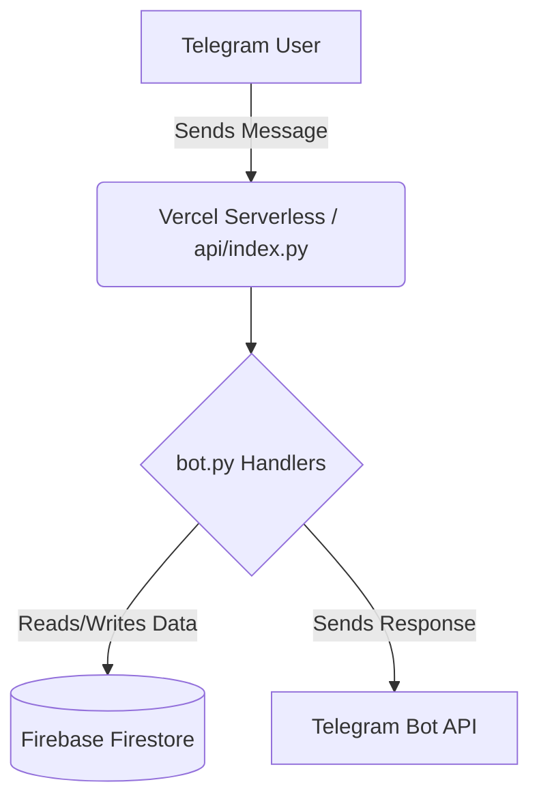

# 🤖 Anonymous Chat Bot for Telegram


A feature-rich, open-source Telegram anonymous chat bot built with Python. It features **Firebase Firestore** for database management, **inline buttons**, **mini-games**, an improved smart registration flow, and built-in **Vercel deployment** support for serverless hosting.

---

## ✨ Features

- **🔥 Cloud Storage:** Powered by Firebase Firestore. All user data is securely stored in the cloud (no local JSON files).
- **🔘 Interactive UI:** Uses inline buttons for gender selection, interest picking, match accept/decline, and chat controls.
- **🎮 Built-in Mini-Games:** Play Dice, Rock-Paper-Scissors, Number Guessing, and Truth or Dare directly in the chat!
- **📋 Smart Registration:** Robust name, age, and location validation with a user-friendly, button-based gender and interest selection.
- **💬 Enhanced Chatting:** Seamlessly relays messages and includes inline controls right within the chat interface.
- **👑 Admin Panel:** Built-in admin commands to manage the bot (`/stats`, `/broadcast`, `/ban`, `/unban`, `/deleteuser`).
- **🌐 Vercel Deploy Ready:** Includes `api/index.py` and `vercel.json` for easy webhook mode serverless hosting.
- **🔄 Local Development:** Supports polling mode out-of-the-box when `WEBHOOK_URL` is not set.

---

## 🚀 Quick Start

### 1. Clone the Repository

```bash
git clone https://github.com/yourusername/anonymous-chat-bot.git
cd anonymous-chat-bot
```

### 2. Set Up Firebase

1. Go to the [Firebase Console](https://console.firebase.google.com) and create a new project.
2. Enable **Firestore Database** (start in production mode).
3. Navigate to **Project Settings → Service Accounts** and click **Generate new private key**.
4. Download the JSON key file.
   - **For local dev:** Rename it to `serviceAccountKey.json` and place it in the root directory.
   - **For Vercel:** Copy the **entire JSON content** into the `FIREBASE_KEY_JSON` environment variable.

### 3. Environment Variables

Create a `.env` file for local development or set these up in your deployment environment:

| Variable | Description |
|---|---|
| `BOT_TOKEN` | Your Telegram bot token from [@BotFather](https://t.me/BotFather) |
| `ADMIN_USER_ID` | Your Telegram user ID (get from [@userinfobot](https://t.me/userinfobot)) |
| `FIREBASE_KEY_JSON` | Full stringified content of your Firebase service account JSON |
| `WEBHOOK_URL` | Your Vercel app URL (e.g. `https://your-app.vercel.app`) - Leave empty for local dev |
| `PORT` | *(Optional)* Defaults to `8443` |

### 4. Local Development

Install the dependencies and run the bot in polling mode:

```bash
pip install -r requirements.txt

# Ensure serviceAccountKey.json is in the project root
# Leave WEBHOOK_URL unset so the bot uses polling mode

python bot.py
```

### 5. Deploy to Vercel

```bash
npm install -g vercel
vercel login
vercel --prod
```

1. Set the environment variables in your **Vercel Dashboard → Settings → Environment Variables**.
2. After deployment, register your webhook with Telegram by visiting this URL in your browser:

```text
https://api.telegram.org/bot<YOUR_BOT_TOKEN>/setWebhook?url=https://your-app.vercel.app/webhook
```

---

## 🎮 Bot Commands

### User Commands

| Command | Action |
|---|---|
| `/start` | Register or access the welcome back menu |
| `/find` | Find a random chat partner (or use the 🔍 Find Partner button) |
| `/stop` | End the current chat |
| `/profile` | View and edit your profile (or use the 👤 My Profile button) |
| `/help` | Show the help message |

### Admin Commands

*Only accessible by the user with the `ADMIN_USER_ID`.*

| Command | Action |
|---|---|
| `/stats` | Show bot statistics (total users, active chats, etc.) |
| `/broadcast <msg>` | Send a message to all registered users |
| `/ban <user_id> [reason]` | Ban a user from using the bot |
| `/unban <user_id>` | Unban a previously banned user |
| `/deleteuser <user_id>`| Delete a user from the database |

---

## 🗂️ Database Structure (Firestore)

```text
users/
  {user_id}/
    name, age, gender, place, bio, interest
    chatting_with, waiting_for_acceptance
    joined_at, updated_at, chat_count

banned_users/
  {user_id}/
    reason, banned_at
```

---

## 🔧 Architecture



---

## 📝 Important Notes

- **Matchmaking Queue:** The waiting queue is currently in-memory. It resets on server restarts, which is typically acceptable for serverless environments. For persistent queues, consider storing them in Firestore.
- **Matching Logic:** The bot matches opposite genders by default. Users who select "Other" as their gender can match with anyone.
- **Mini-Games:** All game results are automatically shared with the active chat partner to ensure fair play.

---

## 🤝 Contributing

Contributions, issues, and feature requests are welcome! Feel free to check the [issues page](https://github.com/yourusername/anonymous-chat-bot/issues).

## 📄 License

This project is [MIT](LICENSE) licensed.